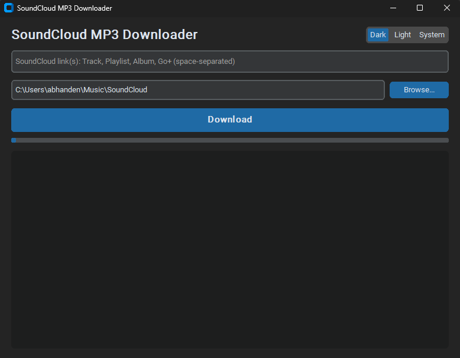
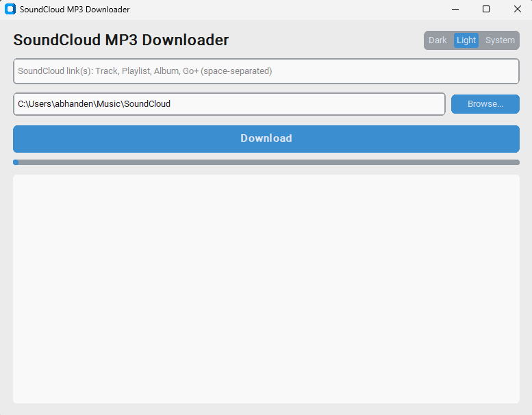

# SoundCloud MP3 Downloader & Cover-Art Extractor


[](https://abhanden.github.io/SoundCloudMP3Downloader/)

Desktop app (GUI) that downloads SoundCloud tracks, playlists and albums as **real MP3 files (320 kbps)** and embeds **artist, title and high-res cover art** directly into the ID3 tags.


---

## Screenshots

| Dark Mode | Light Mode |
|-----------|------------|
|  |  |


---

## Features

- Single tracks, playlists, albums and Go+ links
- Forced MP3 conversion via FFmpeg (320 kbps target, no M4A leftovers)
- Cover art for **every** track: URL is forced to `t500x500.jpg`, converted to a real JPEG with Pillow
- ID3v2.3 tags via `mutagen` (title, artist, album, front cover) - works in Windows Explorer, Mp3tag, most players
- Verification after tagging: every track is re-read from disk (cover present? real bitrate?)
- Progress bar + log console
- Dark / Light / System theme
- Custom FFmpeg location via `--ffmpeg-location`

---

## Requirements

- Python 3.9+
- [FFmpeg](https://ffmpeg.org/download.html) (including `ffprobe`)

### Install FFmpeg

| OS | Command |
|----|---------|
| Windows | `winget install ffmpeg` or download from [gyan.dev](https://www.gyan.dev/ffmpeg/builds/) and unzip |
| macOS | `brew install ffmpeg` |
| Linux (Debian/Ubuntu) | `sudo apt install ffmpeg` |

---

## Installation

```bash
git clone https://github.com/abhanden/SoundCloudMP3Downloader.git
cd SoundCloudMP3Downloader
python -m venv venv
venv\Scripts\activate        # Linux/macOS: source venv/bin/activate
pip install -r requirements.txt
```

---

## Usage

### FFmpeg is in your PATH

```bash
python app.py
```

### FFmpeg is NOT in your PATH

Point the app to the folder that contains `ffmpeg` and `ffprobe`:

```bash
# Windows
python app.py --ffmpeg-location "C:\ffmpeg\bin"

# macOS / Linux
python app.py --ffmpeg-location /opt/ffmpeg/bin
```

You can also pass the path to the `ffmpeg` binary itself. Alternative without the flag: put `ffmpeg.exe` and `ffprobe.exe` next to `app.py`.

### CLI options

| Option | Description |
|--------|-------------|
| `--ffmpeg-location PATH` | Folder with ffmpeg/ffprobe (or path to the ffmpeg binary) |
| `-h`, `--help` | Show help |

### In the app

1. Paste one or more SoundCloud links (space-separated).
2. Choose the target folder (default: `~/Music/SoundCloud`).
3. Click **Download**.
4. The log shows each track, e.g. `OK: Artist - Title.mp3 | 320 kbps | cover: yes`.

---

## How it works

```
SoundCloud URL
      |
      v
 yt-dlp  ->  best audio stream
      |
      v
 FFmpeg  ->  MP3 (320 kbps)
      |
      v
 Pillow  ->  cover (t500x500) -> real JPEG
      |
      v
 mutagen ->  ID3v2.3: TIT2, TPE1, TALB, APIC
```

---

## Project structure

```
.
├── app.py              # GUI + download + tagging
├── requirements.txt
├── .gitignore
├── README.md
└── docs/               # GitHub Pages site (index.html, style.css, script.js)
```

---

## Troubleshooting

| Problem | Fix |
|---------|-----|
| `ffmpeg not found` | Install FFmpeg or start with `python app.py --ffmpeg-location "<path>"` |
| Files are not MP3 | FFmpeg missing or broken - check the log for errors |
| No cover in the player | Check the log line: `cover: NO` means no thumbnail could be downloaded |
| Only 30 s of a Go+ track | Without login SoundCloud only provides the preview |
| `Unable to extract ...` | Update yt-dlp: `pip install -U yt-dlp` |

Note: the real audio quality is limited by SoundCloud's source (usually 128 kbps MP3 or 256 kbps AAC). 320 kbps is the encoding target.

---

## Legal

This tool is for personal use. Only download tracks you have the rights to or that the artist has released for download. Respect SoundCloud's Terms of Use and copyright law. You are responsible for what you download.

---

## License

MIT - see `LICENSE`.

## Credits

[yt-dlp](https://github.com/yt-dlp/yt-dlp) · [FFmpeg](https://ffmpeg.org) · [mutagen](https://github.com/quodlibet/mutagen) · [CustomTkinter](https://github.com/TomSchimansky/CustomTkinter) · [Pillow](https://python-pillow.org)
